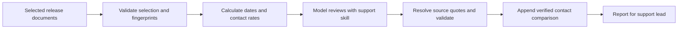

# Instructions, tools and runtime

The whole product is an assistant for a support lead. The skill supplies its review process. Python validates inputs, calculates exact quantities and writes reports. Codex provides the model runtime through the person's existing login.



This is a bounded workflow: the program controls the sequence and computes helpers before the model writes. The model does not choose tools or browse company systems. Each review starts a fresh session; explicitly supplied prior reports provide release history.

| Tool or command | What it does | What it cannot prove |
| --- | --- | --- |
| `prepare` | Validates selected paths/fingerprints; shows date and telemetry arithmetic | Whether support is ready |
| `calendar_checks` | Finds timestamps and computes 72 hours earlier | Which launch is authoritative; whether the notice was sent |
| `signal_checks` | Validates totals/exposure/windows; computes rates, ratio and absolute increase | Cause, significance or refund entitlement |
| `capacity` | Computes handling minutes/extra hours from contacts, AHT and reserve | Demand, queue waits or an accepted staffing booking |
| Input/citation/report validators | Check file selection, exact current quotations, structure and history identity | Whether the quotation supports the interpretation |
| `review` | Runs the model, preserves evidence and writes recommendations | Human approvals or execution |

The final agent report includes a verified contact comparison. `calculation_provenance` identifies the helper contribution; the resolved model response is saved separately. A control/checklist review does not receive this specialized contribution. Staffing capacity is a separate command; the runner does not automatically extract and call it from prose staffing notes.

## Supply your own release

Put Markdown, text, JSON or CSV documents under `inputs/` in a separate release folder. A manifest lists release/snapshot IDs, a timezone-aware `as_of_utc`, whether it is synthetic, and relative paths with SHA-256 fingerprints. The six demo manifests show the format. Recalculate fingerprints after source changes; stale ones are rejected before a model call.

```sh
python3 -m readiness review /path/to/release/snapshot.json \
  --root /path/to/release --output /path/to/private-reviews/review-01
```

Keep outputs outside `inputs/`, `evaluation/` and `source-material/`, and choose a new folder. Add earlier `report.json` files with `--history` and keep the same `--sequence` for the next stage. Different releases, variants, sequences and future histories are rejected.

Preparation is manual; there are no live document or CRM connectors. [The portable skill](../skills/support-release-readiness/SKILL.md) is loaded directly by the runner. A host using it independently must enforce its own access boundary; instructions alone cannot do so.

For telemetry, use the demo CSV schema: timezone-aware window start/end, exposed-account count, contact-category counts and their total. Put the baseline row first and the rollout row second. A two-row comparison requires equal window lengths and positive exposure; category totals must match. Timestamp arithmetic assumes UTC, and month-only dates use the snapshot year. Supply explicit years around year boundaries. The model still decides which release and policy the supplied records describe.

The live-tested runtime is Python 3.11.8 and Codex CLI 0.162.1 on macOS. Software tests need no model call. Other hosts/CLI versions have not received the same live sandbox verification. This repo does not install a global skill or app.
